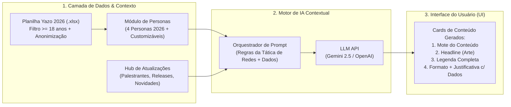

# 📋 PRD — Sistema Gerador de Pautas e Conteúdo com IA (Festival Iguassu Inova 2026)

**Versão:** 1.0 (Inicial)  
**Data:** 16 de Outubro de 2026  
**Local do Projeto:** `C:\xampp\htdocs\festivaliguassuinova\gerador de pautas`  
**Base de Dados Analisada:** `Inscrições-Festival Iguassu Inova-16-10-2026 16_10_42.xlsx` (Yazo Tickets 2026)

---

## 1. Análise de Viabilidade: É possível criar este sistema e segmentar pelos inscritos?

### 1.1. Viabilidade Técnica: **100% Viável (Alta Maturidade)**
Sim, é **totalmente possível** criar este sistema e executá-lo localmente (em Node.js/Vite ou PHP/Python no XAMPP) ou em nuvem, conectando os dados reais do projeto a uma API de LLM (como **Google Gemini 2.5 Flash / Pro** ou **OpenAI GPT-4o**).

Por que a viabilidade para o **Festival Iguassu Inova 2026** é excepcionalmente alta?
1. **A planilha de inscritos de 2026 (Yazo Tickets) já possui variáveis comportamentais estruturadas em JSON:** Diferente de 2025 (Sympla), o formulário de 2026 coleta explicitamente:
   - **Coluna 29 (`Perfil`):** Segmenta exatamente quem é Estudante, Professor/Educador, Pesquisador/Cientista, Empresário/Executivo, Empreendedor/Startupeiro, Investidor, Profissional Privado/Público, Autônomo e Entusiasta/Comunidade.
   - **Coluna 41 (`Interesses`):** Array JSON com até 3 interesses escolhidos pelo inscrito (*Arte & Cultura, Tecnologias do Futuro, Negócios & Marketing, Aprendizagem do Futuro, Corpo & Mente, Sustentabilidade, Impacto Social, Geeks & Games, Transição Energética, Turismo Sustentável, Agro*).
   - **Coluna 42 (`Objetivos no Festival`):** Array JSON com a motivação real (*Explorar novas tendências, Participar de atividades culturais, Conhecer novas tecnologias, Ampliar networking, Buscar negócios/investimento, Apresentar pesquisa*).
   - **Coluna 43 (`Programação desejada`):** Indica se o inscrito vem só pelos *Shows nacionais*, pela *Programação diurna + networking* ou pela *Programação completa*.
   - **Colunas 19, 21, 23 e 45 (`Geografia e Logística`):** Cidade, se mora em Foz do Iguaçu, Bairro e Meio de Transporte (*Transporte público, Carro particular, App/Táxi, Ônibus oficial*).
2. **Base de Conhecimento Rica já existente no repositório:** O projeto já conta com o documento canônico `llms-full.txt` (6 Mundos, 4 Shows Nacionais, 15 Keynotes), o *Passaporte de Imprensa* (Circuito Esquenta, "O Festival é Seu") e a *Tática de Redes Sociais 2026* (Grade semanal Terça a Sexta, gargalo do canal único Instagram vs. LinkedIn/WhatsApp do Itaipu Parquetec).

### 1.2. Conformidade com LGPD (Privacidade por Design)
Para usar os dados dos inscritos com inteligência artificial **sem expor dados pessoais sensíveis**:
- O módulo de ingestão de planilhas lê o `.xlsx` localmente, **descarta automaticamente menores de idade** e **remove colunas de identificação pessoal (PII)** como Nome, CPF (`Documento`), Telefone, E-mail e QR Code.
- O modelo de IA recebe apenas **estatísticas agregadas e cruzamentos reais do segmento** (ex: *"No segmento Alunos Universitários (n=2.268), 43,7% dependem de transporte público, 59,6% têm interesse em Arte & Cultura e 41,8% em Tecnologias do Futuro"*), garantindo zero vazamento de dados pessoais e 100% de precisão estatística nas pautas geradas.

---

## 2. Diagnóstico da Base de Inscritos 2026 (Filtro: Maiores de Idade)

A partir do processamento da base `Inscrições-Festival Iguassu Inova-16-10-2026 16_10_42.xlsx`:
- **Total de registros na planilha:** 7.888 inscrições (7.887 válidas, 1 cancelada).
- **Menores de idade ignorados/removidos:** **822 inscritos** (310 ingressos `< 14 anos` + 472 autodeclarados menores na coluna 25 + 40 com data de nascimento `< 18 anos`).
- **Base Adulta Consolidada ($\ge 18$ anos):** **7.065 inscritos adultos válidos**.

### Distribuição dos 4 Segmentos Solicitados na Base 2026:
| Segmento / Persona | Critério de Recorte na Planilha 2026 (` Maior de 18 anos `) | Volume Real (16/10/2026) | % da Base Adulta |
| :--- | :--- | :---: | :---: |
| **1. Universitário: Professores e Pesquisadores** | `Perfil` = *Professor(a) / Educador(a)* ou *Pesquisador(a) / Cientista* | **1.046** | **14,8%** |
| **2. Universitário: Alunos** | `Perfil` = *Estudante* ($\ge 18$ anos) | **2.268** | **32,1%** |
| **3. Comunidade Foz do Iguaçu** | `Mora em Foz = Sim` + Perfis não-acadêmicos e não-empresariais (*Entusiasta/Comunidade, Autônomo, Setor Privado/Público, OSC*) | **2.677** *(sendo 543 estritamente "Entusiasta/Comunidade")* | **37,9%** |
| **4. Público Empresário** | `Perfil` = *Empresário(a) / Executivo(a)*, *Empreendedor(a) / Startupeiro(a)* ou *Investidor(a)* | **501** | **7,1%** |
| *Outros (Visitantes de fora de Foz não-acadêmicos/não-empresários)* | Moradores de outras cidades em perfis gerais | *573* | *8,1%* |

---

## 3. As 4 Personas Oficiais 2026 (Criadas com Base nos Dados Reais dos Inscritos)

Abaixo estão as **4 Personas Data-Driven** extraídas diretamente da base de inscritos de 2026 (ignorando menores de idade), que alimentarão o motor de IA do Gerador de Pautas:

---

### 👩‍🏫 Persona 1: Dra. Helena — Público Universitário (Professores e Pesquisadores)
> *"Quero conectar minha pesquisa e meus alunos às transformações reais do mercado e viver uma experiência cultural inspiradora."*

* **Representatividade na Base 2026:** **1.046 inscritos adultos** (790 Professores/Educadores + 256 Pesquisadores/Cientistas).
* **Perfil Demográfico Real:**
  * **Idade:** Média de **38,7 anos** (Mediana: **39 anos**).
  * **Gênero:** **65,0% Feminino** | 32,8% Masculino | 1,5% Não-binárie.
  * **Geografia:** **70,8% moram em Foz do Iguaçu** (Bairros topo: *Porto Belo 5,2%, Centro 4,8%, Vila A 3,8%, Lancaster 2,9%*) e **29,2% vêm da região** (*Cascavel 4,0%, Toledo 2,6%, Medianeira 1,9%*).
  * **Principais Instituições:** **UNILA (8,2%)**, **UNIOESTE (3,6%)**, **IFPR (2,1%)**, **SEED (1,1%)**, **UTFPR (1,0%)**, **UDC (0,6%)**.
* **Top 5 Interesses Reais (Coluna 41):**
  1. 🎨 **Arte & Cultura:** **64,2%**
  2. 📚 **Aprendizagem do Futuro:** **47,4%** *(maior índice entre todas as personas!)*
  3. 🌱 **Sustentabilidade:** **41,3%** *(maior índice entre todas as personas!)*
  4. 🧘 **Corpo & Mente:** **39,7%**
  5. 🤝 **Impacto Social:** **39,6%** *(seguido de perto por Tecnologias do Futuro com 37,4%)*
* **Top Objetivos no Festival (Coluna 42):**
  1. Participar de atividades culturais (**77,5%**)
  2. Explorar novas tendências e adquirir conhecimento (**77,0%**)
  3. Conhecer novas tecnologias e soluções (**51,2%**)
  4. Ampliar networking (**33,3%**)
  5. **Apresentar minha pesquisa (11,5%)** *(índice 2x maior que alunos e 6x maior que comunidade!)*
* **Comportamento de Programação, Aquisição e Logística:**
  * **Intenção de Agenda:** **50,2%** querem a **Programação Completa (Shows + Diurno)**; 25,1% focam nos Shows; 15,6% focam nas Palestras/Painéis diurnos.
  * **Como soube:** Redes Sociais do Festival (**60,9%**), Indicação (**20,8%**), **Escola ou Universidade (15,2%)**, E-mail/Newsletter (**7,2%** — maior taxa de conversão por e-mail da base).
  * **Meio de Transporte:** Carro particular (**60,6%**), Transporte público (**14,5%**), App/Táxi (**11,8%**), Ônibus oficial do Festival (**6,0%**).
* **Diretriz para a IA Geradora de Pautas:**
  * **Mundos-Âncora:** **Mundo Sapiens**, **Mundo FICiências** (orientadores de projetos) e **Mundo Itaipu Parquetec**.
  * **Gatilhos de Conteúdo:** Valorização da ciência aplicada, submissão/exposição de pesquisas (*O Festival é Seu* / *Sapiens*), intersecção entre educação, sustentabilidade e cultura (shows de Arnaldo Antunes, Emicida, palestras de Drauzio Varella e Monja Coen).
  * **Tom de Voz:** Intelectualmente estimulante, valorizador da ciência e educação, acolhedor e cultural.

---

### 🎓 Persona 2: Lucas & Sofia — Público Universitário (Alunos $\ge 18$ anos)
> *"Busco descobrir tecnologias do futuro, fazer conexões pro meu início de carreira, garantir horas complementares e curtir os shows com a galera."*

* **Representatividade na Base 2026:** **2.268 inscritos adultos** (32,1% de todos os adultos inscritos).
* **Perfil Demográfico Real:**
  * **Idade:** Média de **25,2 anos** (Mediana: **23 anos**).
  * **Gênero:** **60,9% Feminino** | 36,3% Masculino | 1,5% Não-binárie.
  * **Diversidade Étnica:** Maior diversidade da base (53,0% Branca, 24,5% Parda, **11,7% Preta**, **2,5% Indígena**).
  * **Geografia:** **74,1% moram em Foz do Iguaçu** (*Centro 6,9%, Porto Belo 5,9% — polo UNILA/Parquetec, Vila A 3,7%, Morumbi 3,0%, Vila C 2,6%*) e **25,9% vêm de fora** (*Cascavel, Santa Terezinha, Medianeira, Toledo, Ciudad del Este*).
  * **Principais Universidades:** **UNILA (30,7% somando siglas)**, **UNIOESTE (11,6%)**, **UDC (3,4%)**, **UCP - Paraguai (2,6%)**, **Descomplica UniAmérica (2,0%)**, **IFPR (1,8%)**, **CESUFOZ (1,7%)**, **UTFPR (1,3%)**, **UPAP (1,2%)**.
* **Top 5 Interesses Reais (Coluna 41):**
  1. 🎨 **Arte & Cultura:** **59,6%**
  2. 🚀 **Tecnologias do Futuro:** **41,8%**
  3. 🧘 **Corpo & Mente:** **38,7%**
  4. 🤝 **Impacto Social:** **33,1%**
  5. 📚 **Aprendizagem do Futuro:** **30,5%** *(seguido de Negócios & Marketing 30,1%, Sustentabilidade 29,2% e **Geeks & Games 28,3%** — maior volume absoluto de gamers da base: 641 alunos!)*
* **Top Objetivos no Festival (Coluna 42):**
  1. **Explorar novas tendências e adquirir conhecimento: 76,9%** *(objetivo #1 acima de cultura!)*
  2. Participar de atividades culturais (**64,3%**)
  3. Conhecer novas tecnologias e soluções (**51,3%**)
  4. **Ampliar meu networking: 41,8%**
  5. Buscar oportunidades de negócio (**15,4%**) e Apresentar pesquisa (**5,7%**)
* **Comportamento de Programação, Aquisição e Logística:**
  * **Intenção de Agenda:** **49,2%** querem **Programação Completa**; **18,9%** priorizam **Palestras/Oficinas diurnas e networking**; 18,7% Shows nacionais.
  * **Como soube:** Redes Sociais do Festival (**53,7%**), **Escola ou Universidade (27,2% — 1 em cada 4 alunos veio pela faculdade!)**, Indicação de amigos (**22,2%**).
  * **Meio de Transporte (Alerta Crítico de Pauta!):** **43,7% vão de Transporte Público (990 alunos!)** e **7,2% de Ônibus Oficial do Festival**, enquanto apenas 28,5% usam carro particular.
* **Diretriz para a IA Geradora de Pautas:**
  * **Mundos-Âncora:** **Mundo Sapiens** (games, tecnologia, universidades), **Mundo Itaipu Parquetec** (hackathons, carreira, IA) e **Mundo FIMS** (shows de Emicida, Duda Beat, Os Garotin).
  * **Gatilhos de Conteúdo:** Certificado oficial de horas complementares, dicas práticas de como chegar de ônibus/transporte público, conflito de calendário acadêmico (provas/recesso UNILA e UNIOESTE em 21/11), palestras de Wendel Bezerra, Rapha do RH, Gabriela Prioli e Emicida.
  * **Tom de Voz:** Dinâmico, jovem, prático, visual (Reels rápidos, memes universitários, carrosséis de carreira/sobrevivência no festival).

---

### 🏘️ Persona 3: Carla & Família — Público Comunidade Foz do Iguaçu
> *"Quero aproveitar um grande evento gratuito na minha cidade, assistir aos shows nacionais, conhecer novidades e viver um programa diferente pós-expediente ou no fim de semana."*

* **Representatividade na Base 2026:** **2.677 moradores adultos de Foz do Iguaçu** fora do eixo acadêmico/empresarial (sendo **543** autodeclarados estritamente como *Entusiasta / Comunidade*, além de trabalhadores locais do comércio/empresas privadas, autônomos e servidores municipais).
* **Perfil Demográfico Real:**
  * **Idade:** Média de **35,8 anos** (Mediana: **34 anos**).
  * **Gênero:** **60,2% Feminino** (chegando a **61,3% Feminino** no recorte estrito *Entusiasta/Comunidade*).
  * **Geografia (Bairros de Foz do Iguaçu):** Espalhados por toda a cidade — **Centro (10,8%)**, **Vila A (3,9%)**, **Campos do Iguaçu (3,7%)**, **Morumbi (3,4%)**, **Lancaster (3,2%)**, **Porto Belo (2,9%)**, **Porto Meira (2,8%)**.
* **Top 5 Interesses Reais (Coluna 41):**
  1. 🎨 **Arte & Cultura:** **63,5%** *(chega a **72,6%** no grupo estrito Entusiasta/Comunidade!)*
  2. 🧘 **Corpo & Mente:** **44,5%** *(maior percentual de toda a base! Saúde, bem-estar, qualidade de vida)*
  3. 💼 **Negócios & Marketing:** **40,5%** *(forte presença de autônomos/freelancers locais buscando renda)*
  4. 🚀 **Tecnologias do Futuro:** **40,1%**
  5. 📚 **Aprendizagem do Futuro (30,2%)** & **Impacto Social (30,0%)**
* **Top Objetivos no Festival (Coluna 42):**
  1. **Participar de atividades culturais:** **71,1%** *(77,5% no recorte estrito Comunidade)*
  2. Explorar novas tendências e adquirir conhecimento (**74,0%**)
  3. Conhecer novas tecnologias e soluções (**50,0%**)
  4. Ampliar networking (**39,5%**)
* **Comportamento de Programação, Aquisição e Logística:**
  * **Intenção de Agenda:** **30,6% vêm exclusivamente pelos Shows Nacionais** (maior taxa de toda a base!) e **46,2% querem a Programação Completa**.
  * **Como soube:** **Redes Sociais do Festival (68,1% — o público mais dependente do Instagram!)** e **Indicação de amigos/familiares (24,5% — forte efeito boca a boca no WhatsApp)**.
  * **Meio de Transporte:** Carro particular (**65,0%**), App/Táxi (**13,8%**), Transporte público (**12,6%**).
* **Diretriz para a IA Geradora de Pautas:**
  * **Mundos-Âncora:** **Mundo FIMS** (Shows gratuitos: Duda Beat, Emicida, Arnaldo Antunes, Os Garotin), **Mundo RME** (para autônomas locais), **Mundo Itaipu Parquetec** (gastronomia, lazer e bem-estar).
  * **Gatilhos de Conteúdo:** **100% Gratuito** (quebra de objeção financeira), tradução do festival sem jargões técnicos ("não é só para cientista ou empresário"), destaque para temas de **Corpo & Mente** (Drauzio Varella, Monja Coen, Gustavo Arns, Regina Tchelly na gastronomia), guia prático de estacionamento, horários dos shows e segurança para ir com a família/amigos.
  * **Tom de Voz:** Acolhedor, festivo, claro, zero "corporativês", focado em pertencimento local.

---

### 💼 Persona 4: Rodrigo & Camila — Público Empresário (Empresários, Empreendedores e Investidores)
> *"Não vou ao festival só para passear: quero fazer conexões estratégicas, descobrir tendências de negócios e tecnologia que gerem retorno para minha empresa e encontrar parceiros."*

* **Representatividade na Base 2026:** **501 inscritos adultos de alta decisão** (231 Empresários/Executivos + 213 Empreendedores/Startupeiros + 57 Investidores).
* **Perfil Demográfico Real:**
  * **Idade:** Média de **37,4 anos** (Mediana: **36 anos**).
  * **Gênero:** Equilíbrio com liderança feminina (**51,7% Feminino** | **46,1% Masculino** — forte conexão com o novo **Mundo RME**!).
  * **Cargos Reais Declarados:** *CEO (9,2%), Proprietário/Dono (9,8%), Diretor (3,4%), Administrador(a)/Sócio(a) (5,0%)*.
  * **Geografia:** **77,4% são de Foz do Iguaçu** (*Centro 11,6%, Vila A 3,6%, Morumbi 3,4%, Panorama 3,0%*) e **22,6% vêm de fora** (*Curitiba 3,0%, Cascavel 2,2%, Toledo 1,8%, Medianeira 1,4%*).
* **Top 5 Interesses Reais (Coluna 41):**
  1. 📈 **Negócios & Marketing:** **73,7%** *(dominância absoluta!)*
  2. 🎨 **Arte & Cultura:** **45,3%**
  3. 🚀 **Tecnologias do Futuro:** **43,3%**
  4. 🧘 **Corpo & Mente:** **34,9%** *(liderança consciente, saúde mental executiva)*
  5. 📚 **Aprendizagem do Futuro:** **30,1%** *(seguido de Sustentabilidade 22,0% e **Turismo Sustentável 18,8%** — estratégico para o trade de Foz!)*
* **Top Objetivos no Festival (Coluna 42):**
  1. Explorar novas tendências e adquirir conhecimento (**74,1%**)
  2. **Ampliar meu networking:** **59,5%** *(maior índice de networking de toda a base!)*
  3. Conhecer novas tecnologias e soluções (**48,7%**)
  4. Participar de atividades culturais (**42,9%**)
  5. **Buscar oportunidades de negócio:** **41,5%** *(+ **19,0% Buscar oportunidades de investimento** e **13,2% Investir ou conhecer startups**!)*
* **Comportamento de Programação, Aquisição e Logística:**
  * **Intenção de Agenda:** **48,3% Programação Completa** e **21,2% focados estritamente na Programação Diurna + Networking** (maior taxa diurna da base).
  * **Como soube:** Redes Sociais (**58,1%**), **Indicação de amigos/pares (27,1% — maior taxa de indicação da base!)**, **Influencer/Portal (6,2%)**, **E-mail/Newsletter (5,8%)**.
  * **Meio de Transporte:** **Carro particular (73,5%)** e **App/Táxi (13,0%)** (Apenas 6% usam transporte público).
* **Diretriz para a IA Geradora de Pautas:**
  * **Mundos-Âncora:** **Mundo Itaipu Parquetec** (rodadas de negócios, startups, inovação aberta), **Mundo RME** (51,7% do segmento empresarial inscrito são mulheres!), **Mundo Summit Tour** (trade turístico) e **Mundo FIMS** (negócios da música).
  * **Gatilhos de Conteúdo:** Foco em ROI do tempo investido, nomes de peso de negócios (**Caito Maia**, **Paulo Nobre**, **Ana Fontes**, **André Carvalhal**, **Rapha do RH**), chamada para submeter soluções no **"O Festival é Seu"**, dados de impacto (+50 mil visitantes, +530 cidades).
  * **Tom de Voz:** Direto, executivo, orientado a oportunidades, networking qualificado e visão de futuro (ideal tanto para Instagram quanto para desdobramento no LinkedIn do Itaipu Parquetec).

---

## 4. Visão Geral do Produto e Arquitetura Funcional

### 4.1. Objetivo do Sistema
Um aplicativo web local/cloud (**Gerador Inteligente de Pautas — Iguassu Inova 2026**) localizado em `C:\xampp\htdocs\festivaliguassuinova\gerador de pautas` que cruza automaticamente:
1. **Métricas Reais dos Inscritos 2026** (Interesses, Objetivos, Bairros, Transporte, Instituições);
2. **As 4 Personas Oficiais** (Professores/Pesquisadores, Alunos Universitários, Comunidade Foz, Empresários);
3. **Contexto Vivo e Atualizações do Festival** (6 Mundos, Palestrantes confirmados, Shows, Releases de Imprensa e novas ideias imputadas pelo time);

Para gerar, via **Inteligência Artificial (LLM)**, pautas acionáveis para as redes sociais no formato exato exigido pela equipe de comunicação.

---

## 5. Especificação dos Módulos do Sistema (Requisitos Funcionais)

### Módulo 1: Imputação de Dados de Inscritos e Atualização de Métricas (`RF-01`)
* **Upload de Planilha (`.xlsx` / `.csv`):** Permite subir novas exportações da plataforma Yazo Tickets (como o arquivo `Inscrições-Festival Iguassu Inova-16-10-2026 16_10_42.xlsx`) conforme o número de inscritos cresce até novembro.
* **Higienização e Filtro Automático:**
  * Ignora automaticamente inscritos cancelados (`Status != Válido`).
  * **Ignora automaticamente menores de idade** (`Ingresso` contendo "menor de 14 anos", `Coluna 25 == "Sim"` ou idade calculada `< 18 anos`).
  * Remove CPF, Telefone, E-mail e Nome antes de qualquer envio para a IA.
* **Dashboard Rápido de Interesses por Persona:** Exibe visualmente o ranking atualizado de Interesses (Coluna 41), Objetivos (Coluna 42), Programação (Coluna 43) e Logística (Coluna 45) de cada uma das 4 personas.

### Módulo 2: Gestão de Personas (`RF-02`)
* **4 Personas Nativas Pré-Carregadas:** *Universitário Professores/Pesquisadores*, *Universitário Alunos*, *Comunidade Foz do Iguaçu* e *Público Empresário*, já abastecidas com os dados reais da planilha de 16/10/2026.
* **Recálculo Dinâmico:** Quando uma nova planilha de inscritos é importada no Módulo 1, as porcentagens de interesses, objetivos, bairros e transporte das 4 personas são atualizadas automaticamente.
* **Cadastro / Edição Manual de Persona:** Permite ao usuário editar dores, objeções, tom de voz ou criar uma nova sub-persona específica (ex: *"Empreendedoras do Mundo RME"* ou *"Turistas do Paraguai/Argentina"*).

### Módulo 3: Hub de Atualizações do Festival (`RF-03`)
* **Base Nativa pré-carregada (`llms-full.txt` + `Passaporte Imprensa`):**
  * Os 6 Mundos (*Itaipu Parquetec, FICiências, Sapiens, Summit Tour, FIMS, RME*).
  * Os 4 Shows Nacionais (*Os Garotin, Duda Beat, Arnaldo Antunes, Emicida*).
  * Os 15 Palestrantes Confirmados (*Drauzio Varella, Caito Maia, Monja Coen, Gabriela Prioli, Edmílson, Wendel Bezerra, Paulo Nobre, Ana Fontes, Regina Tchelly, Gustavo Arns, Ikaro Kadoshi, André Carvalhal, Samuka, Rapha do RH, Adonias Freestyle*).
  * Programas especiais (*Circuito Esquenta*, *O Festival é Seu*).
* **Imputação Rápida de Novidades:** Campo/formulário onde o usuário cola ou cadastra:
  * **Novo Palestrante / Atração**
  * **Release de Imprensa** (texto bruto ou link do CMS de Imprensa)
  * **Informação Importante / Aviso Logístico** (ex: linhas de ônibus, abertura de inscrições de oficinas, mudança de horário)
  * **Ideia Solta / Briefing Rápido** (ex: *"fazer um post conectando a palestra do Caito Maia com os empresários de Foz"*)

### Módulo 4: Gerador de Pautas com IA e Interface de Resultado (`RF-04`)
Na tela principal do gerador, o conteudista tem total controle criativo combinando seletores rápidos com um **campo aberto de Ideia Inicial**:

1. **💡 Campo de Ideia Inicial / Briefing do Conteudista (Texto Livre — Opcional):**
   * Uma caixa de texto em destaque onde o conteudista pode escrever seu rascunho, insight, gancho, trend do momento ou direcionamento específico antes de clicar em gerar.
   * **Exemplos práticos do que o conteudista pode digitar:**
     * *"Quero fazer um carrossel estilo '5 motivos para não perder a palestra do Caito Maia' focado em quem tem pequeno negócio em Foz"*
     * *"Ideia de Reels mostrando que mais de 40% dos universitários vão de ônibus e explicando como chegar no Itaipu Parquetec sem perrengue"*
     * *"Post de esquenta conectando o show do Emicida com os projetos de impacto social da UNILA"*
   * **Dois Modos de Operação:**
     * **Modo 1 — Guiado pela Ideia do Conteudista (Com texto preenchido):** A IA usa a ideia inicial do conteudista como **fio condutor central**, enriquecendo-a com os dados reais da Persona selecionada (interesses, dores, bairros, transporte) e com as informações oficiais do Festival para estruturar o Mote, a Headline, a Legenda e a Justificativa do Formato.
     * **Modo 2 — Ideação 100% Automática (Campo em branco):** Se o conteudista estiver sem ideias e deixar o campo vazio, a IA cruza sozinha os dados da Persona + a Atualização/Mundo selecionado e propõe ideias inéditas do zero.
2. **Persona(s)-Alvo:** (Uma das 4 personas de 2026 ou cruzamento entre elas);
3. **Foco / Atualização do Festival:** (Seleciona um palestrante, show, release/novidade já cadastrada no Hub ou nenhum específico);
4. **Mundo Relacionado / Dia da Grade Semanal:** (Ex: *Terça: Futuro/Universitários*, *Quarta: Ciência*, *Quinta: B2B*, *Sexta/FDS: Lazer/Comunidade*);
5. **Quantidade de Conteúdos a gerar:** (Ex: 1, 3 ou 5 variações de pauta a partir daquela ideia).

#### Estrutura Obrigatória de Saída na User Interface (UI):
Para cada conteúdo solicitado, a interface renderiza um **Card Estruturado** com botão de copiar individual, botão de **Refazer / Ajustar esta Pauta** e salvamento automático no histórico:

> **📌 Conteúdo [N]**
> * **🎯 Mote do Conteúdo:** Explicação clara do ângulo criativo/estratégico e de qual dor/interesse real da persona ele ataca (ex: conectando os 41,8% de interesse em *Tecnologias do Futuro* dos alunos com a dor do transporte público).
> * **🖼️ Headline (Texto da Arte / Capa / Tela a Tela):** O texto curto, magnético e direto que vai diagramado na peça visual (ou nos slides do carrossel / gancho de tela do Reels).
> * **✍️ Legenda para Redes Sociais:** Copy completa pronta para publicação, respeitando o tom de voz da persona, quebra de objeções (ex: `100% Gratuito`, certificado de horas), Call to Action (CTA) para a Yazo Tickets e hashtags oficiais.
> * **📐 Formato Recomendado + Justificativa Baseada em Dados:** Definição do formato ideal (*Reels curto, Carrossel educativo, Card único de impacto, Artigo/Post LinkedIn Parquetec, Sequência de Stories*) acompanhado da **justificativa técnica e estatística** (cruzando os dados reais da planilha 2026 daquela persona + diretrizes da Tática de Redes do Festival).

### Módulo 5: Histórico Automático de Pautas & Refinamento Individual ("Refazer Pauta") (`RF-05`)
* **Histórico Automático de Pautas Criadas:**
  * Toda pauta gerada pela IA é salva automaticamente no banco local (`saved-pitches.json` / banco de dados) com data/hora, persona utilizada, atualização do festival associada e ideia inicial.
  * Aba dedicada **"Histórico de Pautas"** com busca por palavra-chave, filtro por Persona ou Mundo, opção de favoritar e exportar.
* **Refazer / Ajustar uma Pauta Específica (Iteração Individual com IA):**
  * Caso o conteudista não goste de uma pauta específica (ou queira ajustá-la depois lá no Histórico), cada Card possui o botão **"🔄 Refazer / Ajustar esta Pauta"**.
  * Ao clicar, abre-se uma caixa de refinamento na própria pauta onde o usuário pode:
    1. **Solicitar mudanças em texto livre para a IA:** (Ex: *"Não gostei desse gancho, quero algo mais bem-humorado"*, *"Encurte a headline para caber em 1 linha"*, *"Cite também o show da Duda Beat"*).
    2. **Alterar parâmetros específicos daquela pauta:** Mudar o Formato (ex: forçar troca de *Carrossel* para *Reels Curto*), trocar o Tom de Voz ou trocar a Persona/Atração vinculada.
  * A IA reescreve **apenas aquela pauta específica** sem apagar as demais do lote e guarda a versão anterior (`v1`, `v2`) para que o conteudista possa comparar ou desfazer se preferir.

---

## 6. Arquitetura Técnica Recomendada para Desenvolvimento

Para que o sistema seja rápido de desenvolver, fácil de usar pela equipe na pasta `C:\xampp\htdocs\festivaliguassuinova\gerador de pautas` e não dependa de infraestrutura complexa:

* **Arquitetura:** Aplicação Web Local/Portátil (Frontend Moderno + Persistência Local em Disco/XAMPP + Processador de Planilhas via `SheetJS/xlsx` + Integração com a API do **Google Gemini**).
* **Por que essa stack?**
  1. Segue o padrão já utilizado com sucesso no projeto, permitindo rodar localmente no ambiente XAMPP/Node com zero perda de dados.
  2. Pré-carrega os dados gerados diretamente da planilha `Inscrições-Festival Iguassu Inova-16-10-2026 16_10_42.xlsx` para que o sistema **já abra funcionando imediatamente com os 7.065 adultos mapeados**, além de permitir arrastar e soltar (Drag & Drop) novas planilhas `.xlsx` na própria interface.
  3. Salva automaticamente todo o **Histórico de Pautas Criadas** e as **versões refeitas/ajustadas** no banco de dados local.

---

## 7. Próximos Passos (Plano de Construção do MVP)

1. **Etapa 1 — Processador de Dados 2026:** Script que lê `gerador de pautas/dados publico inscrito 2026/*.xlsx`, filtra os menores de idade e gera o banco estruturado das 4 Personas com todas as estatísticas reais de interesses, objetivos, bairros, instituições e logística.
2. **Etapa 2 — Interface Completa do Gerador de Pautas:**
   * Aba **1. Gerador de Pautas IA** (Campo de Ideia Inicial do Conteudista, Seletores de Persona/Mundo/Atualização, exibição dos Cards com *Mote, Headline, Legenda e Formato + Justificativa* e botão **"🔄 Refazer / Ajustar esta Pauta"** em cada card).
   * Aba **2. Histórico de Pautas Criadas** (Listagem automática de todas as pautas já geradas, filtros por Persona/Mundo, comparação de versões refeitas e reabertura para novos ajustes).
   * Aba **3. Personas & Dados 2026** (Visualização interativa das 4 Personas criadas, gráficos de interesses reais dos 7.065 adultos, editor de personas e botão de upload de nova planilha Yazo `.xlsx`).
   * Aba **4. Hub do Festival (Contexto & Releases)** (Cadastro de novos palestrantes, releases de imprensa, novidades e informações importantes que alimentam a IA).
3. **Etapa 3 — Motor de IA Contextual (Geração + Refinamento Individual):** Integração com API do Google Gemini (`gemini-2.5-flash`) tanto para criar lotes de pautas quanto para reescrever uma pauta específica com novos parâmetros/instruções do conteudista.
