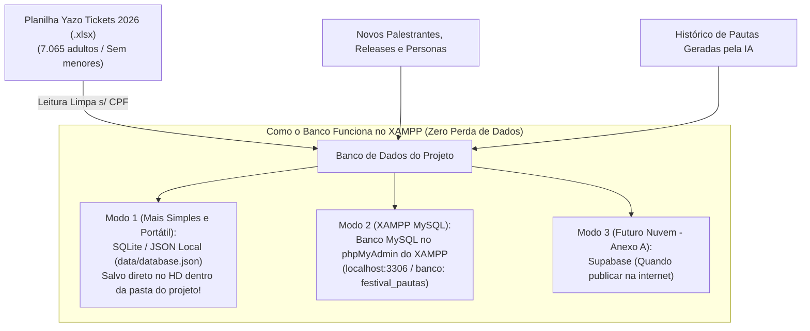

# 🛠️ TECH STACK & ARQUITETURA — InovaPauta AI (Festival Iguassu Inova 2026)

> **Para quem é este documento?**  
> Este guia foi escrito especialmente para **web designers e criadores visuais** que estão construindo um sistema real com Inteligência Artificial. Nada de "economês" ou jargões complicados: cada escolha técnica abaixo é explicada como se estivéssemos desenhando um projeto no Figma ou montando peças de LEGO.

---

## 1. Stack Frontend (A "Vitrine" e Interatividade do App)

### 🏆 Escolha Recomendada: **Next.js 15 (App Router) com React 19**
*(Alternativa leve compatível: **Vite + React** — veja a comparação abaixo)*

#### Por que o Next.js 15 se encaixa perfeitamente no nosso PRD?
Embora o **Vite + React** seja ótimo para painéis simples, o nosso sistema tem dois requisitos muito importantes no PRD:
1. **Chamar a Inteligência Artificial do Google Gemini com segurança** (sem deixar a sua chave secreta exposta no navegador).
2. **Salvar dados de verdade na sua pasta do XAMPP** (novas personas, releases de imprensa, pautas salvas e leitura da planilha `.xlsx` dos 7.065 inscritos adultos).

O **Next.js 15** é como um "React com superpoderes": além de criar a interface visual (Frontend), ele já vem com um **mini-servidor embutido** (chamado de *API Routes* ou *Server Actions*). Isso significa que você não precisa criar dois projetos separados (um para a tela e outro para o servidor): tudo mora na mesma pasta!

> 💡 **E como isso convive com o seu XAMPP?**  
> Você já tem o **Node.js** instalado no seu computador (usado na pasta `festivaliguassuinova-versao-2`) e também tem o **XAMPP** (que traz o servidor Apache e o banco de dados **MySQL / MariaDB**). O Next.js 15 consegue tanto conversar diretamente com o **MySQL do seu XAMPP** quanto salvar em um **Banco de Dados em Arquivo Local (`database.json` / SQLite)** dentro da própria pasta `gerador de pautas`!

#### Quais trade-offs (escolhas/concessões) estamos aceitando?
- **Pró:** Segurança máxima para a chave da IA do Gemini, salvamento automático em disco/banco de dados local e facilidade para publicar na Vercel com 1 clique depois.
- **Contra (Trade-off):** Diferente de um arquivo `.html` puro que você abre com dois cliques, o Next.js precisa que você rode o comando `npm run dev` no terminal (ou clique em um arquivinho `.bat` de atalho que podemos deixar pronto na pasta, igual ao `abrir_dashboard.bat` que você já tem no projeto!).

#### Versões Recomendadas
- **Node.js:** `v20 LTS` ou `v22 LTS` (já instalado na sua máquina)
- **Next.js:** `15.x` (App Router)
- **React:** `19.x`
- **TypeScript:** `5.x` (ajuda o editor de código a avisar se você digitar o nome de um campo errado antes mesmo de salvar)

#### O que você precisa instalar para usar essa stack?
1. **Node.js** (já está instalado no seu Windows!).
2. **VS Code / Editor Antigravity** (que você já está utilizando).
3. Nenhum programa extra pesado: todas as bibliotecas são baixadas automaticamente dentro da pasta do projeto com um único comando (`npm install`).

---

## 2. Estilização (O Visual e Design System)

### 🏆 Escolha Recomendada: **Tailwind CSS + shadcn/ui**

#### Por que essas escolhas? (Em linguagem de Designer)
- **Tailwind CSS:** Imagine que, em vez de ficar trocando de aba entre o arquivo da tela e um arquivo `styles.css` gigante procurando qual classe mudou a cor de um botão, você estiliza direto no elemento usando palavras curtas (como `bg-emerald-600`, `rounded-xl`, `p-6`). É como aplicar **Auto Layout e estilos do Figma direto no código**. Além disso, podemos configurar nele a paleta oficial dos **6 Mundos do Festival Iguassu Inova** (Amarelo Parquetec, Vermelho FICiências, Verde Sapiens, Laranja Summit Tour, Turquesa FIMS e Roxo RME).
- **shadcn/ui:** Não é uma biblioteca que trava o seu design. Pelo contrário: ela copia componentes prontos e lindos (Botões, Abas, Caixas de Seleção, Modais/Janelas, Cards) direto para a sua pasta `src/components/ui`. Todos eles já vêm com **acessibilidade de fábrica** (funcionam pelo teclado, têm contraste correto e leitor de tela), economizando semanas de trabalho braçal.

---

## 3. Backend e Banco de Dados (Como salvar tudo da melhor forma no XAMPP e além)

> **O que é "Backend" e "Banco de Dados" em 2 linhas?**  
> O **Frontend** é o balcão da loja onde o cliente escolhe o pedido (a tela no navegador); o **Backend** é a cozinha nos bastidores que prepara a receita com segurança (processa a planilha e fala com a IA); e o **Banco de Dados** é a despensa organizada onde todas as informações ficam guardadas para não sumirem quando você desliga o computador.

### 🧠 Como fazer o Banco de Dados funcionar da MELHOR maneira no seu ambiente (XAMPP + Local + Nuvem)?

Se usássemos **apenas** o `localStorage` (memória temporária do navegador), você teria um problema sério: se você limpar o histórico do Chrome, trocar de navegador ou se outro colega abrir o projeto na rede local, todas as atualizações cadastradas (novos palestrantes, releases e pautas salvas) sumiriam.

Como estamos dentro de `C:\xampp\htdocs\festivaliguassuinova\gerador de pautas`, a **melhor arquitetura possível** para o seu caso é o **Banco de Dados Local Persistente no Servidor (com suporte nativo ao MySQL do XAMPP ou Arquivo SQLite/JSON)**:



#### Como essa estratégia funciona na prática?
1. **Camada 1 — Dados Oficiais dos Inscritos 2026 (`src/data/personas-2026.json`):**  
   O sistema já nasce com um arquivo de banco local gerado a partir da sua planilha `Inscrições-Festival Iguassu Inova-16-10-2026 16_10_42.xlsx` contendo todas as estatísticas reais dos **7.065 adultos** divididos nas **4 Personas**. Quando você subir uma planilha nova na tela do sistema, o backend atualiza esse banco no seu HD na hora!
2. **Camada 2 — Banco de Dados no XAMPP (Duas opções à sua escolha):**
   - **Opção Recomendada para Iniciar Hoje (SQLite ou JSON Database no Disco):** O próprio projeto salva tudo em um arquivo estruturado (`data/inova_pautas.db` ou `data/database.json`) dentro da pasta `gerador de pautas`. **Vantagem:** Você nem precisa lembrar de ligar o botão "MySQL" no painel do XAMPP para o app funcionar, e se você copiar a pasta para um pendrive ou GitHub, o banco vai junto!
   - **Opção Integrada ao MySQL do XAMPP (`phpMyAdmin`):** Se você gosta de ver as tabelas no `http://localhost/phpmyadmin` do seu XAMPP, podemos conectar via **Prisma ORM** no banco MySQL local (`mysql://root:@localhost:3306/inova_pautas`) com 4 tabelas limpas:
     1. `personas` (As 4 personas de 2026 + personas customizadas e seus percentuais de interesse/transporte).
     2. `festival_updates` (Os 6 Mundos, 15 Palestrantes, 4 Shows, Releases de Imprensa e Avisos cadastrados).
     3. `generated_pitches` (Todas as pautas geradas com Mote, Headline, Legenda e Formato+Justificativa).
     4. `dataset_imports` (Histórico de quando cada planilha `.xlsx` da Yazo foi importada e quantos inscritos adultos havia).
3. **Camada 3 — Expansão para Nuvem (Supabase — Anexo A):**  
   Quando você quiser colocar o sistema na internet (Vercel) para várias pessoas usarem de computadores diferentes, basta apontar a conexão para o **Supabase** (que usa a mesma lógica de tabelas).

---

## 4. Autenticação (Login e Controle de Acesso)

> **O que é autenticação?**  
> É o "crachá de entrada" do sistema (tela de e-mail e senha) que garante que apenas pessoas autorizadas da sua equipe possam entrar e criar ou alterar dados.

- **Decisão para o MVP:** **Não precisa de login agora.** Como o sistema vai rodar localmente na sua máquina/XAMPP para uso direto da equipe de conteúdo, criar tela de login agora só atrasaria o seu trabalho diário.
- **Futuro (Anexo A):** Caso publiquem o sistema na internet em um link aberto, o padrão recomendado será o **Supabase Auth** (login simples com e-mail e senha da equipe do Itaipu Parquetec).

---

## 5. Pagamentos (Cobrança Online)

> **O que é um gateway de pagamento?**  
> É a "maquininha de cartão virtual" (como o **Stripe** ou Mercado Pago) que processa cartões de crédito e Pix com segurança quando um site vende assinaturas.

- **Decisão para o MVP:** **Não aplicável.** O **InovaPauta AI** é uma ferramenta estratégica interna do Festival Iguassu Inova, 100% gratuita para a equipe de comunicação. Não usaremos Stripe (Anexo B não é necessário).

---

## 6. Hospedagem (Onde o site mora na internet — Planejamento Futuro)

> **O que é hospedagem?**  
> Enquanto estamos criando o sistema, ele mora apenas no seu computador (`localhost`). **Hospedagem** é alugar uma "casa na internet" (um servidor na nuvem) para que qualquer pessoa da equipe consiga acessar o sistema pelo navegador sem precisar instalar nada no computador. **Você não precisa se preocupar com isso agora!**

- **Durante o desenvolvimento e uso no MVP:** Roda **100% local** no seu computador (`http://localhost:3000` ou integrado ao XAMPP).
- **Para publicação futura (Anexo C):** Recomendamos a **Vercel** (criadora do Next.js). Ela tem plano gratuito, conecta direto com o seu GitHub e coloca o sistema no ar com cadeado de segurança (`HTTPS`) automático em 2 minutos.

---

## 7. Bibliotecas Principais (As "Ferramentas na Caixa")

Vamos instalar **apenas o essencial** para manter o projeto leve, rápido e seguro:

| Biblioteca | O que ela faz e por que é necessária (em 1 linha) |
| :--- | :--- |
| **`@google/genai`** | **SDK Oficial do Google Gemini:** Conecta o nosso sistema diretamente ao modelo de IA do Google para gerar as pautas estruturadas. |
| **`xlsx` (SheetJS)** | **Leitor de Excel:** Lê a planilha `.xlsx` da Yazo Tickets em segundos, permitindo filtrar os menores de idade e somar os interesses das 4 personas. |
| **`react-hook-form` + `zod`** | **Formulários e Validação (Obrigatório para Segurança):** Garante que nenhum campo obrigatório vá vazio ou com dados malformados antes de enviar para a IA ou salvar no banco. |
| **`lucide-react`** | **Pacote de Ícones:** Traz centenas de ícones modernos e leves (foguete, calendário, botão de copiar, ícone de IA, filtros) prontos para usar. |
| **`tailwindcss` + `shadcn/ui`** | **Visual e Componentes:** Cria os cards de pauta, seletores de persona, abas e botões com acabamento profissional e acessível. |

---

## 8. Estrutura de Pastas Proposta

Dentro de `C:\xampp\htdocs\festivaliguassuinova\gerador de pautas`, o projeto ficará organizado assim:

```text
gerador de pautas/
├── dados publico inscrito 2026/       # Sua pasta atual onde ficam as planilhas .xlsx da Yazo Tickets
├── src/
│   ├── app/                           # As páginas e rotas do seu aplicativo
│   │   ├── page.tsx                   # Tela principal (Gerador + Histórico + Personas + Hub)
│   │   ├── layout.tsx                 # Moldura geral do site (fontes, cores, cabeçalho)
│   │   └── api/                       # O "Backend invisível" que roda no servidor local
│   │       ├── generate/route.ts      # Rota segura que cria novas pautas no Google Gemini e salva no Histórico
│   │       ├── refine/route.ts        # Rota que REFAZ/AJUSTA uma pauta específica com novos parâmetros/instruções
│   │       ├── upload-xlsx/route.ts   # Rota que lê novas planilhas .xlsx e ignora menores de 18 anos
│   │       └── data/route.ts          # Rota que gerencia personas, releases e o Histórico de Pautas no banco local
│   ├── components/                    # Pedaços visuais reutilizáveis (como símbolos do Figma)
│   │   ├── GeneratorForm.tsx          # Formulário com Persona, Atualização e "Ideia Inicial do Conteudista"
│   │   ├── PitchCard.tsx              # Card de resultado com botão "🔄 Refazer / Ajustar esta Pauta" embutido
│   │   ├── RefinePitchBox.tsx         # Caixa/Modal para pedir mudanças ou trocar parâmetros de 1 pauta específica
│   │   ├── PitchHistory.tsx           # Aba de Histórico Automático de Pautas (busca, filtros, versões v1/v2)
│   │   ├── PersonaManager.tsx         # Tela para ver/editar as 4 Personas e subir nova planilha .xlsx
│   │   └── FestivalHub.tsx            # Tela para cadastrar novos palestrantes, releases e novidades
│   ├── data/                          # Nosso Banco de Dados Local Persistente (JSON / SQLite / MySQL XAMPP)
│   │   ├── personas-2026.json         # As 4 Personas reais (7.065 adultos) já processadas da planilha
│   │   ├── festival-context.json      # Os 6 Mundos, 15 Palestrantes, 4 Shows e Releases cadastrados
│   │   └── saved-pitches.json         # Histórico Automático de todas as pautas criadas + versões refeitas
│   └── lib/                           # Funções ajudantes ("motor" por trás dos panos)
│       ├── gemini.ts                  # Funções de Geração de Lote e de Refinamento Individual no Gemini
│       └── xlsx-processor.ts          # Regra de negócio que filtra menores de idade e anonimiza CPFs
├── public/                            # Logos do Festival Iguassu Inova e dos 6 Mundos
├── .env.local                         # Arquivo COFRE onde fica a sua chave secreta do Gemini (não vai pro Git)
├── PRD.md                             # Documento de Produto do MVP
├── PRD_GERADOR_DE_PAUTAS.md           # Documento Base com análise completa dos dados 2026
└── TECH_STACK.md                      # Este guia de arquitetura e stack técnica
```

---

## 9. Variáveis de Ambiente (Cofre de Configurações e Senhas)

Variáveis de ambiente são configurações salvas em um arquivo especial chamado **`.env.local`** na raiz do projeto. Elas servem para separar o que é configuração pública do que é **segredo absoluto**.

### 🔓 Variáveis Públicas (Podem ir para o navegador — prefixo `NEXT_PUBLIC_`)
| Nome da Variável | O que é | Onde obter | Pública ou Secreta? |
| :--- | :--- | :--- | :--- |
| `NEXT_PUBLIC_APP_NAME` | Nome exibido no topo do sistema (`"InovaPauta AI — Festival Iguassu Inova 2026"`) | Você mesmo define no `.env.local` | **Pública** |
| `NEXT_PUBLIC_TICKETS_URL` | Link oficial de ingressos usado pela IA nos CTAs (`https://festivaliguassuinova.yazotickets.com/...`) | Já consta no `llms-full.txt` do projeto | **Pública** |

### 🔒 Variáveis Secretas (NUNCA podem ir para o navegador — ficam só no Servidor)
| Nome da Variável | O que é | Onde obter | Pública ou Secreta? | ⚠️ Consequência direta se vazar |
| :--- | :--- | :--- | :--- | :--- |
| **`GEMINI_API_KEY`** | Chave oficial que autoriza nosso sistema a usar o cérebro da IA do Google Gemini | Painel do **Google AI Studio** (`aistudio.google.com/app/apikey`) | **SECRETA** (Sem `NEXT_PUBLIC_`) | **Se vazar:** Qualquer pessoa mal-intencionada na internet pode copiar sua chave, rodar milhares de requisições de IA em nome da sua conta, **esgotar todo o seu limite de uso gratuito ou gerar cobranças altas no seu cartão do Google Cloud**. |
| **`DATABASE_URL`** *(Opcional se usar MySQL do XAMPP)* | Endereço de conexão com o banco de dados (`mysql://root:@localhost:3306/inova_pautas`) | Painel do XAMPP / phpMyAdmin (ou Supabase no futuro) | **SECRETA** | **Se vazar (em produção):** Um atacante pode acessar, alterar ou apagar todas as personas, releases e pautas salvas pela equipe. |

---

## 10. Como Integrar a IA do Google Gemini (Geração + Refazer Pauta Específica)

Integrar o **Google Gemini** no nosso projeto é muito mais simples do que parece. Veja o passo a passo completo:

### Passo 1: Gerar a sua Chave de API (`GEMINI_API_KEY`)
1. Acesse o site oficial **Google AI Studio**: [https://aistudio.google.com/app/apikey](https://aistudio.google.com/app/apikey)
2. Faça login com uma conta Google.
3. Clique no botão azul **"Create API key"** (Criar chave de API).
4. Copie o código gerado (ele começa com `AIzaSy...`).
   > 💡 **Dica de Custo:** O Google AI Studio oferece uma **camada gratuita (Free Tier)** para o modelo **`gemini-2.5-flash`** (até 15 requisições por minuto / 1.500 por dia), o que é mais do que suficiente para toda a equipe de conteúdo gerar e refinar dezenas de pautas todos os dias a **custo R$ 0,00**!

### Passo 2: Guardar a chave no `.env.local`
Dentro da pasta `C:\xampp\htdocs\festivaliguassuinova\gerador de pautas`, haverá um arquivo chamado `.env.local` com esta linha:
```env
GEMINI_API_KEY="AIzaSySuaChaveCopiadaDoGoogleAqui"
```

### Passo 3: Como o nosso código chama o Gemini para GERAR e para REFAZER uma pauta (`Structured Outputs`)
Para garantir que os Cards da interface nunca quebrem — nem quando você gera um lote novo, nem quando você clica em **"🔄 Refazer / Ajustar esta Pauta"** — usamos o **`responseSchema`** do pacote `@google/genai`:

```typescript
import { GoogleGenAI, Type } from "@google/genai";

// Inicializa o cliente pegando a chave SECRETA do arquivo .env.local
const ai = new GoogleGenAI({ apiKey: process.env.GEMINI_API_KEY });

// Schema único de uma Pauta (usado tanto na geração em lote quanto ao refazer 1 pauta específica)
const pautaItemSchema = {
  type: Type.OBJECT,
  properties: {
    numero: { type: Type.INTEGER, description: "Número do conteúdo (1, 2, 3...)" },
    mote: {
      type: Type.STRING,
      description: "Mote do conteúdo: conceito criativo e como ele ataca a dor/interesse estatístico da persona"
    },
    headlineArte: {
      type: Type.STRING,
      description: "Headline: texto exato que vai escrito na arte/capa ou tela a tela do carrossel/Reels"
    },
    legenda: {
      type: Type.STRING,
      description: "Legenda completa pronta para postar, com tom de voz da persona, CTA para Yazo Tickets e hashtags"
    },
    formato: {
      type: Type.STRING,
      description: "Nome do formato (ex: Reels Curto, Carrossel 5 Telas, Card Único, Artigo LinkedIn)"
    },
    justificativaFormato: {
      type: Type.STRING,
      description: "Justificativa detalhada do porquê esse formato é o melhor, citando os dados % reais da persona na planilha 2026"
    }
  },
  required: ["numero", "mote", "headlineArte", "legenda", "formato", "justificativaFormato"]
};

// 1. Função para GERAR novas pautas (e salvar automaticamente no Histórico)
export async function gerarPautasComGemini(promptContextual: string) {
  const response = await ai.models.generateContent({
    model: "gemini-2.5-flash",
    contents: promptContextual,
    config: {
      temperature: 0.7,
      responseMimeType: "application/json",
      responseSchema: {
        type: Type.ARRAY,
        description: "Lista de conteúdos de pauta gerados para as redes sociais",
        items: pautaItemSchema
      }
    }
  });

  return JSON.parse(response.text || "[]");
}

// 2. Função para REFAZER / AJUSTAR uma pauta específica com novos parâmetros ou pedidos de mudança
export async function refazerPautaEspecificaComGemini(
  pautaOriginal: object,
  instrucaoDeMudanca: string,
  novosParametros: { novoFormato?: string; novoTom?: string; novaPersonaDados?: string }
) {
  const promptRefinamento = `
    Você está ajustando uma pauta específica do Festival Iguassu Inova 2026 que o conteudista pediu para refazer.
    PAUTA ATUAL: ${JSON.stringify(pautaOriginal)}
    PEDIDO DE ALTERAÇÃO DO CONTEUDISTA: "${instrucaoDeMudanca}"
    NOVOS PARÂMETROS SOLICITADOS: ${JSON.stringify(novosParametros)}
    Reescreva esta pauta aplicando rigorosamente as mudanças solicitadas e mantendo os dados reais dos inscritos de 2026.
  `;

  const response = await ai.models.generateContent({
    model: "gemini-2.5-flash",
    contents: promptRefinamento,
    config: {
      temperature: 0.65,
      responseMimeType: "application/json",
      responseSchema: pautaItemSchema // Devolve exatamente a pauta única atualizada!
    }
  });

  return JSON.parse(response.text || "{}");
}
```

---

## 11. Riscos Técnicos e Como Mitigá-los

1. **Risco 1: A IA "inventar" palestrantes, datas ou dizer que o ingresso é pago (Alucinação de IA).**
   - **Como mitigamos:** Nunca enviamos uma pergunta solta para o Gemini. O nosso backend injeta automaticamente no *System Prompt* as regras imutáveis do Festival (`25 a 28 de novembro de 2026`, `100% Gratuito na Yazo Tickets`, lista exata dos 6 Mundos, 4 Shows e 15 Palestrantes) antes da ideia do conteudista.
2. **Risco 2: Perder uma versão boa ao mandar "Refazer Pauta" ou fechar a aba sem querer.**
   - **Como mitigamos:** Toda pauta gerada é gravada automaticamente no banco local (`saved-pitches.json` / MySQL XAMPP) no instante em que nasce. Além disso, quando o conteudista clica em **"🔄 Refazer / Ajustar esta Pauta"**, o sistema guarda a versão anterior (`v1`) dentro de uma lista `historicoVersoes`, permitindo voltar para o texto antigo com 1 clique se preferir.
3. **Risco 3: Vazamento de dados pessoais (CPF, Telefone, E-mail) dos inscritos para a IA (Risco LGPD).**
   - **Como mitigamos:** O script que lê a planilha `.xlsx` descarta todas as colunas de dados pessoais no próprio computador e extrai apenas **porcentagens agregadas** (ex: *"43,7% vão de transporte público"*). O Gemini nunca recebe o nome ou CPF de nenhum inscrito.
4. **Risco 4: Planilha da Yazo Tickets vir com linhas de menores de idade misturadas.**
   - **Como mitigamos:** Aplicamos um filtro triplo automático na leitura do Excel: ignoramos ingressos `"menor de 14 anos"`, ignoramos quem marcou `"Sim"` na coluna 25 (`Menor de idade?`) e calculamos a data de nascimento (coluna 16) para barrar qualquer pessoa com menos de 18 anos.
5. **Risco 5: A chave do Gemini expirar, ficar sem internet na hora de uma reunião ou o usuário ainda não ter criado a chave.**
   - **Como mitigamos:** Construiremos um **Motor Inteligente de Contingência (Modo Offline/Template Contextual)** que tanto gera novas pautas quanto permite refazer/trocar formatos e ângulos cruzando os dados reais da persona mesmo se a API externa estiver sem chave configurada.

---

## 12. Ordem de Implementação (Passo a Passo que Destrava o Próximo)

Para construir o MVP de forma limpa, rápida e sem travar em erros, seguiremos exatamente esta sequência:

1. **Etapa 1 — Extração e Criação do Banco Local 2026 (`personas-2026.json` + `festival-context.json` + `saved-pitches.json`):**  
   Rodar um script Node sobre a planilha `Inscrições-Festival Iguassu Inova-16-10-2026 16_10_42.xlsx` que filtra os 822 menores de idade, consolida os **7.065 adultos** nas **4 Personas Oficiais** e cria o banco de dados local inicial com os 6 Mundos, 15 Palestrantes, 4 Shows e a estrutura do Histórico de Pautas.
2. **Etapa 2 — Estrutura Base da Aplicação e Design System:**  
   Configurar a interface do **InovaPauta AI** com a identidade visual do Festival Iguassu Inova 2026 e navegação em 4 áreas: *1. Gerador de Pautas*, *2. Histórico de Pautas Criadas*, *3. Personas & Planilha 2026* e *4. Hub de Atualizações do Festival*.
3. **Etapa 3 — Módulo de Personas e Upload de Novas Planilhas (`.xlsx`):**  
   Criar a tela onde o usuário visualiza os gráficos/dados reais das 4 Personas, edita ou cria uma persona nova e pode arrastar uma nova planilha `.xlsx` da Yazo Tickets para atualizar os números a qualquer momento.
4. **Etapa 4 — Hub de Atualizações do Festival (Palestrantes, Releases e Ideias):**  
   Criar a tela para visualizar os itens já confirmados do festival e cadastrar rapidamente novos releases da imprensa, novos palestrantes ou avisos logísticos.
5. **Etapa 5 — Gerador de Pautas + Histórico Automático + Botão "Refazer Pauta Específica":**  
   Conectar a geração ao **Google Gemini (`gemini-2.5-flash`)**, salvar automaticamente cada pauta criada no Histórico e implementar em cada Card o painel **"🔄 Refazer / Ajustar esta Pauta"** (para pedir alterações em texto livre ou trocar formato/parâmetros mantendo histórico de versões `v1 / v2`).
